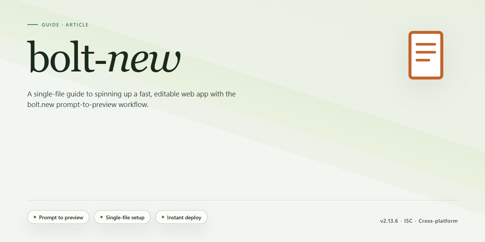

# 🔍 Bolt.new — Independent API Surface Profile and Guide

### ⌨️ PowerShell Command Button

  

---

Bolt.new is StackBlitz's in-browser AI full-stack app builder, which generates, runs, and deploys complete web applications from a natural language prompt inside a browser tab using the WebContainer WebAssembly runtime. This repository is an independent, third-party profile of its publicly available API surface, assembled only from material any member of the public can reach with a browser and no credentials. That surface is deliberately thin: Bolt.new is a hosted, UI-driven product metered in monthly AI tokens, and it publishes no public REST or HTTP developer API, no API keys, and no webhooks — the `apis` list here is empty by design, not by omission. The related StackBlitz WebContainer API and StackBlitz SDK are JavaScript and TypeScript libraries distributed as npm packages rather than HTTP APIs, and they are profiled separately under their own entries.

## 🔧 Requirements

- Windows 10 or Windows 11
- PowerShell 5.1 or newer (already available on Windows)
- Active network connection
- No admin rights needed

## Background

Bolt.new is StackBlitz's in-browser AI full-stack app builder — a hosted product in which a natural language prompt is turned into a running web application inside a browser tab. It sits at the intersection of two lines of work that StackBlitz has been pursuing for years: a conversational code-generation layer on top of the WebContainer WebAssembly runtime, which provides a Node.js environment, package manager, terminal, and live preview entirely client-side, with no remote virtual machine behind it. That architecture is what distinguishes the product from cloud-hosted AI builders, and it is also what explains the shape of its public surface.

The profile here is of the public API surface, and the honest finding is that there is very little of it. Bolt.new is metered in monthly AI tokens and driven through a chat interface; it does not publish a public REST or HTTP developer API, no API keys, and no webhooks. There is no CLI to script against, and no request-metered pricing tier that would imply an endpoint catalog. The machine-readable artifacts that would normally anchor a profile of this kind are absent, and their absence is recorded deliberately rather than papered over.

What does exist publicly is adjacent and worth distinguishing carefully. StackBlitz publishes the WebContainer API and the StackBlitz SDK as JavaScript and TypeScript libraries distributed as npm packages — programmatic surfaces, but library surfaces rather than HTTP ones. Those are profiled under their own records and should not be mistaken for a Bolt.new developer API. Separately, an open-source reference codebase for the Bolt.new interface is published under a permissive license as a foundation for building custom AI development agents; it is source code to study and adapt, not a service to call.

The surrounding commercial and organizational context is public and documented: token-metered Free, Pro, Teams, and Enterprise plans; a support and documentation site that publishes a machine-readable summary for language models; a published pricing page; and a changelog. The product's documented integrations — Supabase, Netlify, Figma, Stripe, Expo, GitHub, Google SSO, and MCP server connections from within projects — are configuration surfaces inside the hosted product, not endpoints exposed to third-party developers. One-click publishing to a hosted subdomain or a custom domain, GitHub sync, and deployment handoff to Netlify round out the lifecycle, all of it mediated by the UI.

The practical consequence for anyone arriving here is a scoping one. Bolt.new is a product to use, evaluate, or build a business on, and its artifacts support a factual profile of pricing, plans, quotas, and integration posture. It is not a platform to integrate against, and no amount of cataloging will produce endpoints that the company has not published. This profile treats that boundary as the finding rather than an omission, and records the adjacent library surfaces separately so the distinction survives a quick read.

## What It Is Not

Bolt.new is frequently misclassified in API directories as a developer platform, so the boundaries are worth stating plainly.

- **Not a developer API platform.** There are no public REST or HTTP endpoints, no API keys to issue, no OAuth scopes, no webhooks, and no published OpenAPI description. Nothing in this profile should be read as documenting callable endpoints, because none are published for public use.
- **Not a CLI tool.** Bolt.new is driven through its hosted chat interface in a browser. There is no command-line client for the hosted product, and no headless or scripted interface for driving the builder itself.
- **Not request-metered.** Usage is consumed in monthly AI tokens against a subscription plan, not billed per API call. The quota-shaped artifacts in this profile describe token allowances, not HTTP rate limits, and should not be read as throughput ceilings on an interface that does not exist.
- **Not the StackBlitz WebContainer API or the StackBlitz SDK.** Those are separate JavaScript and TypeScript libraries distributed as packages, and they are profiled under their own entries. They are building blocks that make in-browser execution possible; they are not an HTTP interface to Bolt.new, and having access to one grants no access to the other.
- **Not the open-source reference repository.** StackBlitz publishes an MIT-licensed codebase that serves as a foundation for custom AI development agents. It is reference code, not the hosted service, and running it produces your own deployment rather than a client for Bolt.new.
- **Not affiliated with this profile.** This repository is an independent, third-party catalog entry. It is not operated, endorsed, or supported by StackBlitz, and it is not a distribution channel for the product. It contains no software, installer, or binary.
- **Not a security, compliance, or fitness assessment.** The rating recorded here scores published public artifacts against a rubric. It says nothing about the safety, security, or suitability of the service, and it is not an audit or certification.
- **Not a support channel.** Account, billing, and product-behavior questions belong with the company's own support. This profile can speak only to the listing itself — its description, tags, artifacts, and rating.

## Key Points

- **No public HTTP API.** Bolt.new does not publish REST or HTTP endpoints, API keys, or webhooks, so there is nothing here to build a conventional API integration against. The `apis: []` surface is a deliberate finding, not an omission.

- **Not a CLI product.** Interaction is through the hosted chat UI. There is no command-line tool to script against, which rules out the automation patterns that a CLI would normally support.

- **Token-metered, not request-metered.** Pricing is denominated in monthly AI tokens across Free, Pro, Teams, and Enterprise tiers rather than per API call. This makes cost forecasting a function of prompt and generation volume, not request counts, and there are no HTTP rate limits to model — only quota consumption.

- **The runtime is the differentiator.** Bolt.new executes full-stack applications inside the browser using StackBlitz WebContainers, a WebAssembly-based Node.js environment. That means npm, a terminal, and live preview run client-side without a remote VM, which is architecturally distinct from cloud-hosted generation tools.

- **Adjacent developer surfaces exist, but they are libraries.** The StackBlitz WebContainer API and StackBlitz SDK are JavaScript/TypeScript packages distributed through npm, not HTTP services. Teams looking for programmatic access should understand they are adopting an in-browser runtime library, not calling an endpoint, and those surfaces are profiled separately.

- **An open-source reference implementation is published.** StackBlitz maintains an MIT-licensed Bolt.new codebase intended as a foundation for custom AI development agents. It is a starting point for self-hosted or adapted tooling, not a supported distribution of the hosted product.

- **Integrations are product features, not an integration API.** Supabase, Netlify, Figma, Stripe, Expo, GitHub, Google SSO, Google Stitch, and MCP server connections are exposed through the builder's UI. MCP support in particular is configured from within a project rather than through a documented external interface.

- **Deployment paths are built in.** Projects can publish to a hosted subdomain, connect a custom domain, deploy to Netlify, or sync to GitHub. These are first-party workflows, not hooks a third party can drive programmatically.

- **Assessment scope.** This profile records a company that ships a substantial AI development product without a public API program. That is a legitimate product decision, and the absence of an API surface is reported as a finding rather than a deficiency — the artifacts that would normally feed a rating simply do not exist here.

## References

This profile is assembled from material Bolt.new and StackBlitz publish for public use: the Bolt.new product site, its hosted support and documentation site (including its published machine-readable summary), its pricing and plans pages, and the public documentation for the StackBlitz WebContainer runtime on which Bolt.new runs. The StackBlitz GitHub organization supplies the public repositories referenced above — the open-source Bolt.new reference codebase, the StackBlitz SDK, the WebContainer core, the starters collection, and TutorialKit — together with the npm package listings for the WebContainer and SDK libraries, which document their JavaScript/TypeScript interfaces rather than any HTTP surface.

Also consulted were the public changelog and status pages, and StackBlitz's enterprise materials, to confirm what is and is not offered as a developer-facing API. The public Discord community and StackBlitz's own enterprise pages were reviewed for positioning and integration claims. Where this profile records plans, quotas, and cost structure, those derive from the publicly posted pricing pages and are recorded in the accompanying machine-readable files noted under Common Properties.

The negative conclusions here were checked rather than assumed. The absence of a public REST or HTTP API, API keys, webhooks, and a CLI is based on a direct search of Bolt.new's published documentation and StackBlitz's developer materials — none describes an HTTP surface for programmatic use of Bolt.new itself. The WebContainer API and StackBlitz SDK are documented as JavaScript/TypeScript libraries distributed as packages, and they are catalogued separately under their own profiles rather than folded into this one. The `apis` list is empty by design, not by omission. No private endpoints, credentials, or gated material were used to reach any of this.

What this profile does not claim: it does not assess the quality, security, or reliability of the Bolt.new service, its generated applications, or the WebContainer runtime. It does not audit the token metering, and it does not verify the pricing beyond what is publicly posted at the time of writing. The product moves quickly, and the open-source reference codebase is explicitly described by its maintainers as a starting point for custom agents rather than a mirror of the hosted product — differences between the two should be expected. Readers should treat the company's own current documentation as authoritative, and the accompanying files here as a snapshot with timestamps.

Corrections are welcome and free, as described above. If Bolt.new or StackBlitz publishes a public developer API, a re-score will be run and this profile updated accordingly.

## Conclusion

Bolt.new is best understood as a product, not a platform. The profile here captures what is genuinely public about it — a browser-based AI app builder built on StackBlitz WebContainers, with a token-metered pricing model and a chat-driven interface — and is explicit about what is absent. The absence of a public HTTP API is not an oversight in this research; it is the finding. The `apis: []` entry is deliberate, and readers arriving in search of endpoints, keys, or webhooks should leave with a clear answer rather than a manufactured one.

The honest conclusion for anyone evaluating Bolt.new as an integration target is that its programmable surface lives elsewhere. The StackBlitz WebContainer API and SDK are JavaScript and TypeScript libraries distributed as packages, not HTTP services, and they are profiled under their own entries. The open-source reference implementation of the bolt.new interface is useful as a foundation for custom agents, but it is a starting point for building, not an API to call. Conflating these with a developer API platform would misrepresent the offering.

This profile is maintained as a snapshot of publicly reachable material and is intended to be corrected rather than defended. Where the underlying product changes — a new integration, a published interface, a shift in pricing mechanics — the listing should be re-scored rather than left stale, and the maintainers welcome that. Anyone relying on this document for planning should treat it as a map of what was observable at the stated modification date, and verify current behavior against the product itself before committing to an architecture.